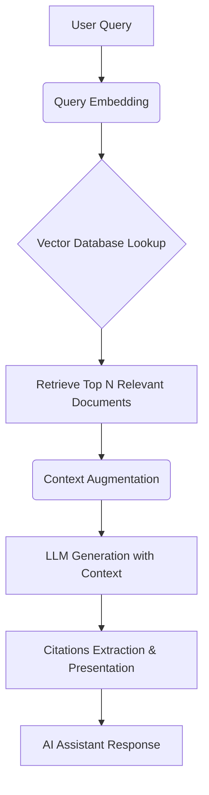

In the fast-paced world of software development and entrepreneurship, access to accurate, up-to-date information isn't a luxury – it's a critical operational requirement. Engineers need to quickly understand new frameworks, founders must validate market opportunities, and product teams need to assess competitive landscapes. Traditionally, this meant hours spent trawling academic papers, documentation, and blog posts. Then came the promise of AI research assistants: instant answers, summaries, and even code snippets.

The allure is undeniable. Imagine cutting research time by 80%, freeing up invaluable engineering hours for building. But this promise often comes with a significant caveat: the "black box" problem. While many AI tools claim to cite sources, the quality, relevance, and veracity of these citations vary wildly. We've all seen the phantom URLs, the links to paywalled papers, or the citations that vaguely relate to the topic but don't actually support the AI's specific claims. For a company like KUNDA, deeply committed to privacy and transparency, relying on unverified or untraceable information is an unacceptable risk. It leads to wasted time verifying, flawed decision-making, and potential reputational damage.

This article cuts through the hype to provide a practical framework for evaluating AI research assistants, focusing on three core pillars: **accuracy**, **traceability**, and **cost**. Our goal is to empower you to leverage AI for research effectively, ensuring the insights you gain are not just fast, but genuinely trustworthy.

## Accuracy: Beyond the Illusion of Knowledge

The primary function of an AI research assistant is to provide accurate information. Yet, Large Language Models (LLMs) are notorious for "hallucinations"—confidently asserting false information. When citations are present, they are often the primary mechanism for mitigating this, but their mere presence doesn't guarantee truth.

### The Quality of Citation Over Quantity

It's tempting to think that more citations mean more reliable information. Not so. A tool that cites ten irrelevant or broken links is less useful than one that cites two highly relevant, authoritative primary sources. When evaluating accuracy, ask:

*   **Are the citations direct and specific?** Do they point to the exact paragraph or sentence that supports the AI's claim, or just a general document?
*   **Are they primary or secondary sources?** For technical details or scientific claims, primary sources (e.g., official documentation, research papers, original code repositories) are far more valuable than secondary summaries.
*   **Are the sources accessible and verifiable?** Broken links, paywalled articles without institutional access, or obscure forums make verification impossible.
*   **Is there evidence of critical synthesis?** A good AI assistant should not just regurgitate information but synthesize it, cross-referencing multiple sources to identify consensus or conflicting viewpoints.

Many modern AI research tools leverage a technique called Retrieval Augmented Generation (RAG). This involves retrieving relevant documents from a knowledge base *before* generating a response, grounding the LLM's output in factual information. However, the quality of the RAG system's retrieval and the prompt engineering defining how the LLM uses those retrieved documents are paramount.

Consider a conceptual RAG pipeline:

The accuracy hinges on `C` (retrieving truly relevant documents) and `F` (the LLM's ability to faithfully use *only* that context for generation, and not hallucinate beyond it). When evaluating, test with queries where you already know the answer, and scrutinize the *specific text* in the cited sources that supposedly supports the AI's claims.

## Traceability: Unpacking the Black Box

For KUNDA, transparency is foundational. In the context of AI research, traceability means understanding *exactly* how the AI arrived at its conclusions and being able to follow that trail back to its original sources. This goes beyond a simple list of links at the end of a summary.

### Granular Source Attribution

A truly traceable AI research assistant will:

1.  **Directly link each statement to its source.** Imagine hovering over a sentence in the AI's output and seeing a popup with the exact snippet from the source document that informed it.
2.  **Highlight relevant sections within the source.** When you click a citation, the tool should ideally open the source document and automatically scroll to/highlight the specific text.
3.  **Indicate the confidence level of a statement.** While nascent, some advanced systems might flag claims derived from less authoritative sources or those where the AI's confidence is lower.

Tools that allow you to interactively explore the source material alongside the generated response offer superior traceability. This is crucial for verifying complex technical details or making high-stakes decisions.

### Data Privacy and IP Considerations

Traceability extends to how your queries and the data sources themselves are handled. As a privacy-first company, KUNDA pays close attention to:

*   **Query Data Handling:** Is your input used for model training? Are queries logged and stored? Always opt for tools with strong data privacy policies, enterprise-grade APIs, or, ideally, self-hosted solutions where you control the data flow.
*   **Source IP:** When an AI summarizes a paywalled academic paper or proprietary documentation, who holds the intellectual property rights to that summary? While fair use often applies to summaries for personal research, commercial applications might require more scrutiny. For critical internal knowledge, a self-hosted RAG system built on your own controlled document corpus is often the most secure and traceable option.

## Cost: Beyond the Subscription Fee

The cost of an AI research assistant isn't just its monthly subscription or API token usage. There are significant hidden costs, particularly related to accuracy and traceability.

### The Hidden Costs of Verification

If an AI research assistant provides answers that require extensive human verification due to poor accuracy or traceability, it's not saving you time—it's shifting the burden. The time your engineers or founders spend:

*   Chasing dead links.
*   Reading entire papers to find one supporting sentence.
*   Cross-referencing multiple AI-generated summaries.
*   Correcting errors based on hallucinated information.

... all represent direct operational costs. A cheaper tool that necessitates more verification might end up being vastly more expensive in terms of developer hours.

### Build vs. Buy: The RAG Equation

For organizations with unique or sensitive knowledge bases, or those requiring ultimate control over data and traceability, the "build" option for a RAG system becomes compelling.

**Building a custom RAG solution involves:**

1.  **Data Ingestion:** Processing your internal documents (markdown, PDFs, code, wikis) into a format suitable for retrieval.
2.  **Embedding:** Converting text into numerical vector representations using an embedding model (e.g., `sentence-transformers`).
3.  **Vector Database:** Storing these embeddings for efficient similarity search (e.g., Pinecone, Weaviate, Qdrant, or even local options like FAISS).
4.  **Orchestration:** Using frameworks like LlamaIndex or LangChain to manage the retrieval and LLM interaction.
5.  **LLM Integration:** Connecting to an open-source LLM (e.g., Llama 3 via Ollama) or a commercial API (e.g., OpenAI, Anthropic) with strict data privacy terms.

While this upfront investment is higher, it offers unparalleled control over accuracy (you curate the knowledge base), traceability (you define how sources are presented), and data privacy. It transforms a black box into a white box, perfectly aligned with KUNDA's ethos.

## Practical Conclusions and Key Takeaways

AI research assistants are powerful tools, but they demand a critical, engineering-minded approach to evaluation. Don't be swayed by marketing claims; test them rigorously against your specific needs for accuracy, traceability, and total cost of ownership.

Here are your key takeaways:

*   **Prioritize Granular Traceability:** Look for tools that link specific statements to specific parts of source documents, not just a list of URLs. This is your primary defense against hallucinations and your path to efficient verification.
*   **Scrutinize Source Quality:** Evaluate *what* is cited. Are they primary, authoritative, and accessible sources? Are they directly relevant?
*   **Account for Hidden Verification Costs:** Factor in the time your team will spend correcting or double-checking AI outputs. A "free" or cheap tool can quickly become the most expensive if it costs you developer hours.
*   **Consider a Hybrid Approach:** Use commercial, general-purpose AI assistants for quick, low-stakes information retrieval. For deep dives, critical decision-making, or sensitive internal knowledge, investigate building a custom RAG solution on your own curated data.
*   **Champion Data Privacy:** For KUNDA, this is non-negotiable. Ensure any AI tool you use adheres to strict data privacy standards, especially regarding your queries and proprietary information.

The goal isn't to replace human intelligence but to augment it *reliably*. By applying these principles, you can harness the power of AI research assistants to accelerate innovation and make better, more informed decisions, without compromising on trust or transparency.
