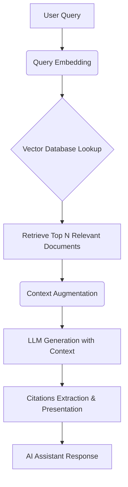

Dans le monde en évolution rapide du développement logiciel et de l'entrepreneuriat, l'accès à des informations précises et à jour n'est pas un luxe, c'est une exigence opérationnelle critique. Les ingénieurs doivent rapidement comprendre de nouveaux frameworks, les fondateurs doivent valider des opportunités de marché, et les équipes produit doivent évaluer les paysages concurrentiels. Traditionnellement, cela impliquait des heures passées à éplucher des articles universitaires, de la documentation et des billets de blog. Puis est venue la promesse des assistants de recherche IA : des réponses instantanées, des résumés, et même des extraits de code.

L'attrait est indéniable. Imaginez réduire le temps de recherche de 80 %, libérant de précieuses heures d'ingénierie pour la construction. Mais cette promesse s'accompagne souvent d'une mise en garde importante : le problème de la "boîte noire". Bien que de nombreux outils d'IA prétendent citer des sources, la qualité, la pertinence et la véracité de ces citations varient considérablement. Nous avons tous vu des URL fantômes, des liens vers des articles payants, ou des citations qui se rapportent vaguement au sujet mais ne soutiennent pas réellement les affirmations spécifiques de l'IA. Pour une entreprise comme KUNDA, profondément engagée envers la confidentialité et la transparence, s'appuyer sur des informations non vérifiées ou intraçables est un risque inacceptable. Cela conduit à une perte de temps en vérification, à une prise de décision erronée et à des dommages potentiels à la réputation.

Cet article démystifie le battage médiatique pour fournir un cadre pratique d'évaluation des assistants de recherche IA, en se concentrant sur trois piliers fondamentaux : la **précision**, la **traçabilité** et le **coût**. Notre objectif est de vous permettre de tirer parti de l'IA pour la recherche de manière efficace, en garantissant que les informations que vous obtenez sont non seulement rapides, mais réellement dignes de confiance.

## Précision : Au-delà de l'illusion de la connaissance

La fonction première d'un assistant de recherche IA est de fournir des informations précises. Pourtant, les grands modèles de langage (LLM) sont réputés pour leurs "hallucinations" – affirmant avec assurance des informations fausses. Lorsque des citations sont présentes, elles sont souvent le mécanisme principal pour atténuer ce problème, mais leur simple présence ne garantit pas la vérité.

### La qualité de la citation avant la quantité

Il est tentant de penser que plus de citations signifie des informations plus fiables. Ce n'est pas le cas. Un outil qui cite dix liens non pertinents ou cassés est moins utile qu'un outil qui cite deux sources primaires très pertinentes et faisant autorité. Lors de l'évaluation de la précision, demandez-vous :

*   **Les citations sont-elles directes et spécifiques ?** Pointent-elles vers le paragraphe ou la phrase exacte qui soutient l'affirmation de l'IA, ou juste un document général ?
*   **S'agit-il de sources primaires ou secondaires ?** Pour les détails techniques ou les affirmations scientifiques, les sources primaires (par exemple, la documentation officielle, les articles de recherche, les dépôts de code originaux) sont bien plus précieuses que les résumés secondaires.
*   **Les sources sont-elles accessibles et vérifiables ?** Les liens brisés, les articles payants sans accès institutionnel, ou les forums obscurs rendent la vérification impossible.
*   **Y a-t-il des preuves de synthèse critique ?** Un bon assistant IA ne devrait pas se contenter de régurgiter des informations, mais les synthétiser, en recoupant plusieurs sources pour identifier le consensus ou les points de vue contradictoires.

De nombreux outils de recherche IA modernes exploitent une technique appelée "Retrieval Augmented Generation" (RAG). Cela implique de récupérer des documents pertinents à partir d'une base de connaissances *avant* de générer une réponse, ancrant ainsi la sortie du LLM dans des informations factuelles. Cependant, la qualité de la récupération par le système RAG et l'ingénierie des invites définissant la manière dont le LLM utilise ces documents récupérés sont primordiales.

Considérez un pipeline RAG conceptuel :

La précision dépend de `C` (la récupération de documents réellement pertinents) et de `F` (la capacité du LLM à utiliser fidèlement *uniquement* ce contexte pour la génération, et à ne pas halluciner au-delà). Lors de l'évaluation, testez avec des requêtes dont vous connaissez déjà la réponse, et examinez attentivement le *texte spécifique* des sources citées qui est censé soutenir les affirmations de l'IA.

## Traçabilité : Décortiquer la boîte noire

Pour KUNDA, la transparence est fondamentale. Dans le contexte de la recherche IA, la traçabilité signifie comprendre *exactement* comment l'IA est arrivée à ses conclusions et être capable de suivre cette piste jusqu'à ses sources originales. Cela va au-delà d'une simple liste de liens à la fin d'un résumé.

### Attribution granulaire des sources

Un assistant de recherche IA véritablement traçable :

1.  **Liera directement chaque affirmation à sa source.** Imaginez survoler une phrase dans la sortie de l'IA et voir apparaître une fenêtre contextuelle avec l'extrait exact du document source qui l'a informée.
2.  **Mettra en évidence les sections pertinentes au sein de la source.** Lorsque vous cliquez sur une citation, l'outil devrait idéalement ouvrir le document source et faire défiler/mettre en évidence automatiquement le texte spécifique.
3.  **Indiquera le niveau de confiance d'une affirmation.** Bien qu'émergents, certains systèmes avancés pourraient signaler les affirmations dérivées de sources moins fiables ou celles où la confiance de l'IA est plus faible.

Les outils qui vous permettent d'explorer de manière interactive le matériel source en parallèle de la réponse générée offrent une traçabilité supérieure. C'est crucial pour vérifier des détails techniques complexes ou prendre des décisions à enjeux élevés.

### Confidentialité des données et considérations de propriété intellectuelle

La traçabilité s'étend à la manière dont vos requêtes et les sources de données elles-mêmes sont traitées. En tant qu'entreprise axée sur la confidentialité, KUNDA accorde une attention particulière à :

*   **La gestion des données de requête :** Votre saisie est-elle utilisée pour l'entraînement du modèle ? Les requêtes sont-elles enregistrées et stockées ? Optez toujours pour des outils dotés de politiques strictes en matière de confidentialité des données, d'API de qualité entreprise ou, idéalement, de solutions auto-hébergées où vous contrôlez le flux de données.
*   **La propriété intellectuelle des sources :** Lorsqu'une IA résume un article académique payant ou une documentation propriétaire, qui détient les droits de propriété intellectuelle sur ce résumé ? Bien que l'utilisation équitable s'applique souvent aux résumés pour la recherche personnelle, les applications commerciales pourraient nécessiter un examen plus approfondi. Pour les connaissances internes critiques, un système RAG auto-hébergé construit sur votre propre corpus de documents contrôlé est souvent l'option la plus sûre et la plus traçable.

## Coût : Au-delà des frais d'abonnement

Le coût d'un assistant de recherche IA ne se limite pas à son abonnement mensuel ou à l'utilisation de jetons API. Il existe des coûts cachés importants, en particulier liés à la précision et à la traçabilité.

### Les coûts cachés de la vérification

Si un assistant de recherche IA fournit des réponses qui nécessitent une vérification humaine approfondie en raison d'une mauvaise précision ou traçabilité, il ne vous fait pas gagner de temps, il déplace le fardeau. Le temps que vos ingénieurs ou fondateurs passent à :

*   Poursuivre des liens morts.
*   Lire des articles entiers pour trouver une seule phrase de soutien.
*   Recouper plusieurs résumés générés par l'IA.
*   Corriger des erreurs basées sur des informations hallucinées.

... tout cela représente des coûts opérationnels directs. Un outil moins cher qui nécessite plus de vérification pourrait finir par être bien plus coûteux en termes d'heures de développement.

### Construire ou acheter : L'équation RAG

Pour les organisations disposant de bases de connaissances uniques ou sensibles, ou celles qui exigent un contrôle ultime sur les données et la traçabilité, l'option de "construire" un système RAG devient très intéressante.

**Construire une solution RAG personnalisée implique :**

1.  **Ingestion des données :** Traiter vos documents internes (markdown, PDF, code, wikis) dans un format adapté à la récupération.
2.  **Intégration vectorielle (Embedding) :** Convertir le texte en représentations vectorielles numériques à l'aide d'un modèle d'embedding (par exemple, `sentence-transformers`).
3.  **Base de données vectorielle :** Stocker ces embeddings pour une recherche de similarité efficace (par exemple, Pinecone, Weaviate, Qdrant, ou même des options locales comme FAISS).
4.  **Orchestration :** Utiliser des frameworks comme LlamaIndex ou LangChain pour gérer la récupération et l'interaction avec le LLM.
5.  **Intégration du LLM :** Se connecter à un LLM open source (par exemple, Llama 3 via Ollama) ou à une API commerciale (par exemple, OpenAI, Anthropic) avec des conditions strictes de confidentialité des données.

Bien que cet investissement initial soit plus élevé, il offre un contrôle inégalé sur la précision (vous gérez la base de connaissances), la traçabilité (vous définissez comment les sources sont présentées) et la confidentialité des données. Il transforme une boîte noire en une boîte blanche, parfaitement alignée avec l'éthique de KUNDA.

## Conclusions pratiques et points clés

Les assistants de recherche IA sont des outils puissants, mais ils exigent une approche critique et une mentalité d'ingénieur pour l'évaluation. Ne vous laissez pas influencer par les arguments marketing ; testez-les rigoureusement en fonction de vos besoins spécifiques en matière de précision, de traçabilité et de coût total de possession.

Voici vos points clés à retenir :

*   **Priorisez la traçabilité granulaire :** Recherchez des outils qui lient des affirmations spécifiques à des parties spécifiques de documents sources, et non seulement une liste d'URL. C'est votre principale défense contre les hallucinations et votre voie vers une vérification efficace.
*   **Examinez minutieusement la qualité des sources :** Évaluez *ce qui* est cité. S'agit-il de sources primaires, faisant autorité et accessibles ? Sont-elles directement pertinentes ?
*   **Prenez en compte les coûts cachés de vérification :** Tenez compte du temps que votre équipe passera à corriger ou à revérifier les résultats de l'IA. Un outil "gratuit" ou bon marché peut rapidement devenir le plus cher s'il vous coûte des heures de développement.
*   **Envisagez une approche hybride :** Utilisez des assistants IA commerciaux et polyvalents pour une récupération rapide d'informations à faible enjeu. Pour des analyses approfondies, des prises de décision critiques ou des connaissances internes sensibles, étudiez la construction d'une solution RAG personnalisée sur vos propres données organisées.
*   **Défendez la confidentialité des données :** Pour KUNDA, c'est non négociable. Assurez-vous que tout outil d'IA que vous utilisez respecte des normes strictes de confidentialité des données, en particulier en ce qui concerne vos requêtes et vos informations propriétaires.

L'objectif n'est pas de remplacer l'intelligence humaine, mais de l'augmenter de manière *fiable*. En appliquant ces principes, vous pouvez exploiter la puissance des assistants de recherche IA pour accélérer l'innovation et prendre des décisions meilleures et plus éclairées, sans compromettre la confiance ou la transparence.
